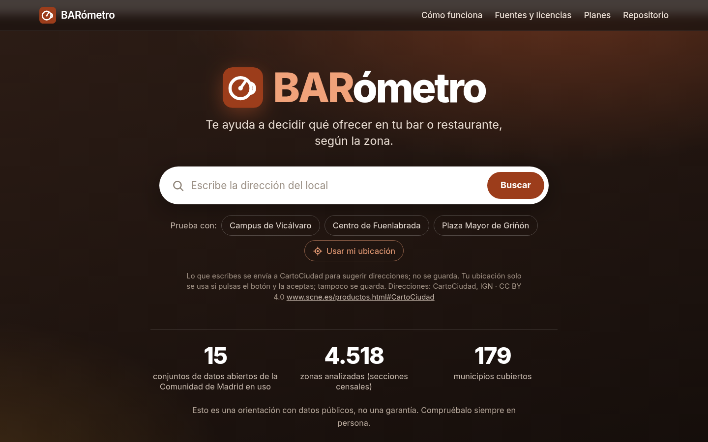
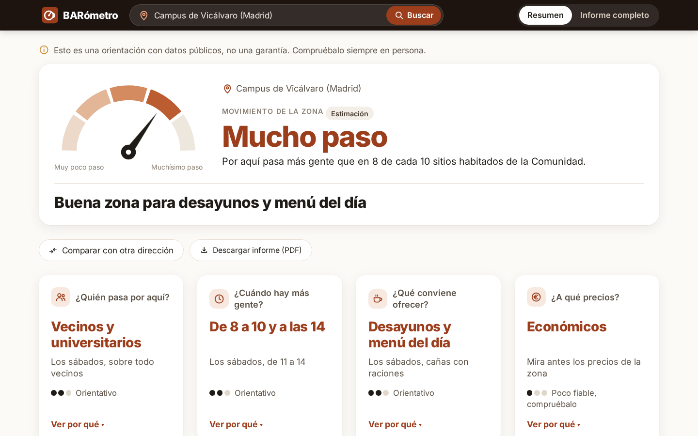
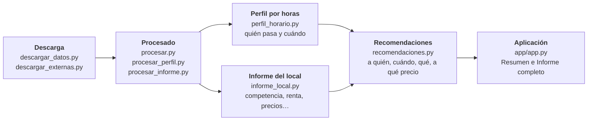

# BARómetro

**BARómetro ayuda a quien tiene o quiere abrir un bar o restaurante en la Comunidad de
Madrid a decidir qué ofrecer, a quién, a qué hora y a qué precios, según la zona.** Se
escribe la dirección del local y, con datos abiertos, se ve cuánto movimiento tiene la
zona, quién pasa por allí, cuándo hay más gente, cómo se llega y qué bares hay ya cerca.

Prototipo para el datathon **DATAMAD 2026** de la Comunidad de Madrid.

**▶ Demo:** <https://barometro-madrid.streamlit.app/>





## El problema y a quién ayuda

Quien abre un bar suele decidir la carta, el horario y los precios por intuición. Los
estudios de mercado cuestan dinero y los datos públicos que servirían están repartidos
en muchos portales y formatos.

BARómetro está pensado para **un hostelero sin conocimientos técnicos**. La vista
principal se lee en diez segundos, con frases cortas y números redondos. Quien quiera
el detalle tiene un «Informe completo» con las cifras, la fiabilidad de cada respuesta
y las fuentes.

## Qué responde y qué no

| Responde | No responde |
|---|---|
| **¿Quién pasa por aquí?** Vecinos, viajeros, universitarios, familias con niños, pacientes, trabajadores… | **No estima la facturación** ni cuántos clientes entrarán |
| **¿Cuándo hay más gente?** Por horas, en un día de diario y en un sábado | **No da precios en euros:** no hay cartas en datos abiertos |
| **¿Qué conviene ofrecer?** Desayunos, menú del día, meriendas, cañas con raciones… | No modela el domingo aparte ni la gente que va a un local a propósito |
| **¿A qué precios?** Económicos, medios o altos, según la zona y quién pasa | No dice si un local concreto es bueno o malo: **no muestra nombres de locales** |
| Qué bares y restaurantes hay ya en 300 metros, avisos y qué comprobar en persona | **No garantiza nada** |
| **¿Pasa mucha o poca gente?** Cinco niveles, de «Muy poco paso» a «Muchísimo paso», frente al resto de la Comunidad | **No valora un local al que se va a propósito o en coche:** solo mide el negocio de paso |
| **¿Cómo se llega?** Redes, líneas y vehículos al día a menos de 300 y de 800 metros, y vecinos y locales a 1 km | No sabe cuánta gente usa cada parada ni si hay aparcamiento |

> **Es una orientación, no una garantía.** Toda cifra de personas es una estimación con
> supuestos explícitos. Cada respuesta lleva su fiabilidad y la aplicación termina
> siempre con una lista de cosas que comprobar en persona antes de decidir.

Lo que dice la aplicación en los tres puntos de prueba:

| | Campus de Vicálvaro | Centro de Fuenlabrada | Plaza Mayor de Griñón |
|---|---|---|---|
| Movimiento | Mucho paso | Muchísimo paso | Poco paso |
| Titular | Buena zona para desayunos y menú del día | Zona de desayunos, con mucha competencia cerca | Aquí encajan sobre todo desayunos y meriendas |
| Quién pasa | Vecinos y universitarios | Viajeros y vecinos | Vecinos y familias con niños |
| Cuándo | De 8 a 10 y a las 14 | De 7 a 10 | A las 8, a las 14 y a las 16 |
| Locales en 300 m | 27 (censo del Ayuntamiento) | 25 (OpenStreetMap) | 2 (OpenStreetMap) |
| Precios | Económicos | Económicos | Medios |
| Cómo se llega | Muy bien comunicado | Muy bien comunicado | Poco transporte |
| A 1 km | ≈46.000 vecinos y 124 locales | ≈78.000 vecinos y 212 locales | ≈4.000 vecinos y 8 locales |

Si se escribe una calle sin número, un municipio o un código postal, la aplicación no
calcula: enseña el punto en el mapa, pregunta «¿Es aquí? Si no, toca el mapa en el sitio
exacto» y espera a que se confirme. En un punto por el que casi no pasa nadie (por
ejemplo, el kilómetro 18 de la M-404, en Griñón) lo dice arriba del todo y atenúa las
respuestas.

## Datos

El centro del análisis son **15 conjuntos del Portal de Datos Abiertos de la Comunidad
de Madrid** ([datos.comunidad.madrid](https://datos.comunidad.madrid)), todos con
licencia Creative Commons Attribution y descargados el 2026-11-10.

<!-- inicio:tabla-portal -->
| Conjunto del portal | Para qué sirve en BARómetro | Última modificación |
|---|---|---|
| [Centros educativos de la comunidad de Madrid](https://datos.comunidad.madrid/dataset/centros_educativos) | Dónde están los colegios e institutos: padres y niños que pasan a la entrada y a la salida | 2026-05-05 |
| [Estadísticas de alumnos de centros educativos de la Comunidad de Madrid](https://datos.comunidad.madrid/dataset/spacm_estadisticas_alumnos) | Cuántos alumnos hay por municipio y enseñanza, para repartirlos entre los centros | 2026-07-22 |
| [Estudiantes matriculados en estudios de Grado presenciales por universidad](https://datos.comunidad.madrid/dataset/1925489) | Estudiantes de grado por universidad, para repartirlos entre los campus | 2026-11-06 |
| [Estudiantes matriculados en estudios de máster presenciales por universidad](https://datos.comunidad.madrid/dataset/1925502) | Estudiantes de máster por universidad, para repartirlos entre los campus | 2026-11-05 |
| [Centros, servicios y establecimientos sanitarios](https://datos.comunidad.madrid/dataset/centros_servicios_establecimientos_sanitarios) | Pacientes que van a centros sanitarios; código postal aproximado del punto | 2026-11-10 |
| [Desfibriladores externos fuera del ámbito sanitario](https://datos.comunidad.madrid/dataset/desfibriladores_externos_fuera_ambito_sanitario) | Sitios con mucha gente (grandes centros de trabajo, instalaciones deportivas, recintos) y su horario | 2026-11-10 |
| [Viajeros subidos y bajados en trenes de cercanias por estaciones](https://datos.comunidad.madrid/dataset/1923861) | Viajeros por estación de Cercanías, para ajustar las estaciones grandes | 2026-11-05 |
| [Secciones censales](https://datos.comunidad.madrid/dataset/secciones_censales) | Límites de la Comunidad y de los municipios | 2025-02-07 |
| [Gasto medio de los hogares por subgrupo de gasto (3 dígitos COICOP/EPF) (Base 2006)](https://datos.comunidad.madrid/dataset/gasto_por_subgrupo_gasto_3_digitos_coicop_epf_base_2006) | Gasto medio por persona en bares y restaurantes | 2026-11-05 |
| [Índice de Precios de Consumo (IPC), por grupo. Base 2025. Comunidad de Madrid y España](https://datos.comunidad.madrid/dataset/ipc_base_2025) | Cuánto han subido los precios de la restauración y de los alimentos | 2026-11-05 |
| [Alojamientos turísticos de la Comunidad de Madrid](https://datos.comunidad.madrid/dataset/alojamientos_turisticos) | Alojamientos turísticos del código postal y del municipio | 2026-11-09 |
| [Declaraciones responsables de actividad de viviendas de uso turístico de la Comunidad de Madrid presentadas](https://datos.comunidad.madrid/dataset/declaraciones_actividad_viviendas_uso_turistico) | Viviendas de uso turístico declaradas en el municipio | 2026-10-14 |
| [Festivos regionales y locales año en curso](https://datos.comunidad.madrid/dataset/festivos_regionales_locales) | Festivos regionales y locales próximos | 2026-01-13 |
| [Demografía empresarial de la Comunidad de Madrid. Unidades empresariales y puestos de trabajo asociados a las unidades empresariales, por rama de actividad (CNAE-2009)](https://datos.comunidad.madrid/dataset/demografia_empresarial_cnae09) | Evolución de las empresas del sector hasta 2025 | 2026-11-05 |
| [Demografía empresarial de la Comunidad de Madrid. Unidades empresariales y puestos de trabajo asociados a las unidades empresariales, por rama de actividad (CNAE-2025)](https://datos.comunidad.madrid/dataset/demografia_empresarial_cnae25) | Altas y bajas de empresas del sector en 2026 | 2026-11-05 |
<!-- fin:tabla-portal -->

Se completan con otras fuentes públicas:

<!-- inicio:tabla-otras -->
| Fuente | Licencia | Descarga |
|---|---|---|
| [INE. Atlas de distribución de renta de los hogares (ADRH), provincia de Madrid, por municipio, distrito y sección censal](https://www.ine.es/dyngs/INEbase/operacion.htm?c=Estadistica_C&cid=1254736177088&idp=1254735976608) | Reutilización libre citando la fuente | 2026-11-09 |
| [INE. Cartografía digitalizada de secciones censales, seccionado a 1 de enero de 2025 (toda España)](https://www.ine.es/ss/Satellite?L=es_ES&c=Page&cid=1259952026632&p=1259952026632&pagename=ProductosYServicios%2FPYSLayout) | Reutilización libre citando la fuente | 2026-11-09 |
| [Censo de locales, sus actividades y terrazas de hostelería y restauración](https://datos.madrid.es/dataset/200085-0-censo-locales) | Creative Commons Attribution 4.0 International (CC BY 4.0) | 2026-11-09 |
| [OpenStreetMap: bares, pubs, cafeterías, restaurantes y comida rápida de la Comunidad de Madrid (API Overpass)](https://www.openstreetmap.org/copyright) | Open Database License (ODbL) 1.0 | 2026-11-09 |
| [OpenStreetMap: recintos universitarios (amenity=university) de la Comunidad de Madrid (API Overpass)](https://www.openstreetmap.org/copyright) | Open Database License (ODbL) 1.0 | 2026-11-10 |
| [Consorcio Regional de Transportes de Madrid (CRTM): estaciones y paradas de Metro, Metro Ligero, Cercanías y autobuses interurbanos y urbanos, y demanda diaria de viajeros por modo](https://datos.crtm.es/) | [Licencia de datos abiertos y estáticos del CRTM](https://www.crtm.es/licencia-de-uso) | 2026-11-10 |
| [CartoCiudad: geocodificador de direcciones (Instituto Geográfico Nacional)](https://www.cartociudad.es/web/portal/directorio-de-servicios/geoprocesamiento) | CC BY 4.0 | no se descarga |
| [OpenStreetMap: teselas del mapa base](https://www.openstreetmap.org/copyright) | Datos con Open Database License (ODbL) 1.0 | no se descarga |
<!-- fin:tabla-otras -->

Las dos tablas se generan con `python src/tablas_readme.py --escribir` a partir de
[`docs/fuentes.md`](docs/fuentes.md), donde está el detalle de cada fuente: enlace,
licencia, versión, fecha y cómo se ha procesado. Las licencias de los datos incluidos
en el repositorio están en [`datos/LICENCIAS.md`](datos/LICENCIAS.md).

No se usan datos de Google Maps, Idealista ni otras webs que prohíben su extracción.

### Los datos se actualizan cada semana

Un flujo de GitHub Actions
([`.github/workflows/actualizar-datos.yml`](.github/workflows/actualizar-datos.yml))
vuelve a descargar todas las fuentes cada lunes de madrugada, las procesa, regenera la
referencia del nivel de movimiento y las dos tablas de arriba, y pasa una comprobación
de calidad ([`src/comprobar_datos.py`](src/comprobar_datos.py)).

- **Por qué:** la licencia del Consorcio Regional de Transportes de Madrid pide mantener
  la información actualizada, y los horarios de Cercanías que publica solo cubren unas
  semanas. De paso se renuevan los locales, los centros y los precios.
- **Nada se publica solo.** Si todo va bien y hay datos nuevos, el flujo abre una
  propuesta de cambios (*pull request*) que la autora revisa y acepta. Nunca escribe en
  la rama principal.
- **Si algo se sale de lo esperado, se detiene:** una capa con muchas más o muchas
  menos filas, una columna de nombres, teléfonos o correos, una población total que no
  cuadra o una red de transporte sin servicio.
- No usa secretos, descarga las fuentes una detrás de otra y reintenta con espera.

Cómo se revisa y se acepta la propuesta: [`docs/despliegue.md`](docs/despliegue.md).

## Cómo funciona



1. **Descarga.** Los conjuntos del portal y las fuentes externas se guardan sin tocar
   en `datos/originales/` (no se suben al repositorio).
2. **Procesado.** Se limpian, se sitúan en el mapa y se quitan nombres, direcciones y
   datos de contacto. El resultado va a `datos/procesados/`.
3. **Perfil por horas.** Se dibuja un círculo de 300 metros alrededor del punto y se
   estima cuánta gente pasa cada hora y de qué tipo. Lo que está más cerca pesa más.
4. **Informe del local.** Ocho bloques: competencia, gasto de los vecinos, precios,
   turismo, festivos, salud del sector, cómo se llega en transporte público (a 300 y a
   800 metros) y qué hay a 1 km. Los dos últimos son solo contexto: las recomendaciones
   siguen usando 300 metros.
5. **Nivel de movimiento.** La gente que pasa en un día laborable se compara con la de
   un punto interior de cada una de las 4.518 secciones censales de la Comunidad, y el
   resultado se da en cinco niveles.
6. **Recomendaciones.** Combinan el perfil y el informe. Cada una lleva su porqué, su confianza
   (alta, media o baja) y si es un dato o una estimación.
7. **Aplicación.** Una portada con un buscador que sugiere direcciones mientras se
   escribe, una vista «Resumen» en lenguaje sencillo y un «Informe completo» con todo
   lo técnico.

Todos los supuestos están en un solo fichero, [`src/supuestos.py`](src/supuestos.py),
cada uno con su comentario.

## Rigor: qué se ha comprobado

- **Coordenadas.** Las del portal están en ETRS89 / UTM 30N. Los desfibriladores
  traen también longitud y latitud, y coinciden a 0 metros.
- **Renta y población.** Las 4.518 secciones censales de la provincia casan con los
  datos de renta de 2024 del INE; la población suma 6.995.318 personas.
- **Alumnos.** El 99,9 % de los alumnos de la estadística queda asignado a un centro.
- **Viajeros.** Las personas por tren o autobús se calibran con la demanda diaria
  real que publica el CRTM, y no con un supuesto. Con ello se vio que los autobuses
  estaban sobrestimados entre un 13 % y un 35 %.
- **Cobertura de OpenStreetMap.** Fuera de Madrid capital faltan locales en
  OpenStreetMap: 1,9 por 1.000 habitantes en Fuenlabrada frente a 5,0 del censo
  oficial de Madrid. La aplicación lo avisa y baja la fiabilidad.
- **Revisión a mano.** Las recomendaciones de los tres puntos se revisaron contra sus
  números y se corrigieron siete resultados que no tenían sentido.
- **Sin nombres.** Se ha comprobado que ningún fichero publicado contiene nombres de
  personas ni de locales.
- **Direcciones.** Solo se calcula con un portal con número o con un punto confirmado
  en el mapa. Probado con una calle sin número, un municipio y un portal exacto.
- **Líneas de transporte.** En cada una de las 15.207 paradas, los vehículos por línea
  suman exactamente los que usa el perfil por horas.
- **Día típico del transporte.** Se revisó, línea a línea, qué circula el día elegido
  de cada red. Se recuperaron los viajes de autobús que se descartaban por no traer
  hora en cada parada (el 15 % de los interurbanos), se cambió el día de interurbanos
  y urbanos para que salgan 21 líneas de la Sierra y se reconstruyó la línea 3 de
  Metro. En los tres puntos de prueba solo cambian los viajeros (entre el −1 % y el
  −20 %); el nivel de movimiento, el titular y las recomendaciones son los mismos.
- **Sin cambios en lo anterior.** Al añadir el nivel de movimiento, los accesos y el
  entorno, el perfil, las recomendaciones y los seis bloques anteriores del informe de
  los tres puntos quedaron idénticos.
- **Despliegue.** Los tres puntos dan exactamente el mismo resultado desde un clon
  limpio del repositorio con Python 3.12, sin datos originales.
- **Contenedor.** La imagen de Docker, construida desde un clon limpio, da en los tres
  puntos la misma huella que el entorno de trabajo, y la aplicación enseña lo mismo.
- **Calidad de los datos.** `src/comprobar_datos.py` hace 37 comprobaciones sobre los
  datos publicados (filas, columnas prohibidas, población, transporte y posición). Se
  probó también con datos estropeados a propósito: los detecta y se detiene.

Cada paso está explicado, con sus pruebas y sus cifras, en
[`docs/registro/`](docs/registro/).

## Limitaciones conocidas

- **Todo lo que es «gente» es una estimación.** Sirve para comparar horas y tipos de
  cliente entre sí, no como recuento real.
- **Gente que pasa no es gente que entra.** Pasar de una a otra es un supuesto.
- **Solo se mide el negocio de paso.** Un local al que se va a propósito o en coche
  (un restaurante de carretera, un asador de fin de semana) no se puede valorar con
  estos datos. Si el nivel es «Muy poco paso», la aplicación lo avisa y atenúa sus
  respuestas.
- **El nivel de movimiento compara estimaciones con estimaciones.** La referencia es un
  punto interior de cada sección censal. En las secciones grandes de campo ese punto
  puede caer lejos de las casas, y el modelo reparte a los vecinos por igual en toda la
  sección: por eso el 10 % más bajo de la referencia son sitios casi vacíos, y un
  pueblo pequeño puede salir con menos paso del que tiene.
- **«Cómo se llega» solo cuenta transporte público.** No hay datos abiertos de
  aparcamiento ni de tráfico. Cuenta líneas y vehículos, no viajeros. Los autobuses
  urbanos de fuera de Madrid son «datos parciales» según el propio Consorcio.
- **La línea 3 de Metro es una estimación.** Los horarios publicados de Metro (de
  2025) traen sus estaciones pero ningún tren. Se le pone la frecuencia media de las
  líneas 1, 2, 4 y 5 (461 trenes al día por estación en laborable) y la aplicación lo
  avisa junto a sus estaciones. La frecuencia real puede ser otra.
- **Hay autobuses sin hora en cada parada.** En 68 líneas interurbanas y 24 urbanas
  los horarios solo dan la hora de salida. Se cuentan todos los autobuses (es un
  dato), pero la hora a la que pasan por cada parada se estima.
- **Líneas que no salen.** La C9 de Cercanías (cerrada por obras desde 2024), 12
  líneas interurbanas y 5 urbanas sin ningún viaje en los horarios publicados (entre
  ellas, las 720 a 728 de Colmenar Viejo) y las que solo circulan en fin de semana.
- **El contexto a 1 km es solo contexto.** Reparte a los vecinos por igual en la
  superficie de cada sección censal y, fuera de Madrid capital, cuenta los locales de
  OpenStreetMap, al que le faltan.
- **Una calle sin número no se calcula hasta confirmar el punto.** El punto que propone
  CartoCiudad para una calle es su centro, no el local. Con un portal, CartoCiudad
  puede situar uno cercano y no el exacto.
- **No hay datos abiertos de entradas por estación de Metro ni por parada de
  autobús:** todas las paradas de una red reciben la misma gente por vehículo. Los
  horarios de Metro publicados son de 2025.
- **Un estudiante que llega en metro cuenta dos veces,** como viajero y como
  universitario.
- **Fuera de Madrid capital,** la competencia sale de OpenStreetMap, al que le faltan
  locales. En municipios pequeños no se puede valorar.
- **Las cenas y las copas casi nunca salen recomendadas:** dependen de que la gente
  vaya a propósito, y eso el modelo no lo capta.
- **El domingo no se modela** y el calendario escolar es un supuesto.
- **El dato del sector mezcla hostelería con comercio y transporte,** y el índice de
  precios mezcla restaurantes con hoteles. No hay datos abiertos más finos.
- **Los horarios de la competencia** solo están en OpenStreetMap, en muy pocos locales.

## Privacidad y ética

- **Sin nombres de personas ni de locales.** Los datos procesados no los guardan, el
  mapa no deja acercarse hasta leer rótulos y el buscador descarta nombres de
  comercios.
- **Lo que se escribe en el buscador no se guarda.** Se envía a CartoCiudad (IGN) para
  sugerir direcciones mientras se escribe y situar la elegida, y la aplicación lo dice.
- **La ubicación del navegador solo se usa si se pide.** «Usar mi ubicación» la pregunta
  al navegador, solo vale si el usuario la acepta y tampoco se guarda.
- **La aplicación no recoge estadísticas de uso.**
- **Lenguaje de orientación,** nunca de garantía, y fiabilidad visible en cada
  respuesta.
- **Atribución de todas las fuentes** en la aplicación, con sus fechas. «Powered by
  CRTM»; © colaboradores de OpenStreetMap.
- Este proyecto **no está respaldado ni patrocinado** por ninguna de las entidades
  que publican los datos.

## Cómo reproducirlo

Hace falta Python 3.12, 3.13 o 3.14.

**Arrancar la aplicación** (el repositorio ya trae los datos procesados que necesita,
14 MB):

```bash
git clone https://github.com/Mengying04/barometro.git
cd barometro
python -m venv .venv && source .venv/bin/activate
python -m pip install -r requirements.txt
streamlit run app/app.py
```

**O con Docker,** sin instalar Python (la imagen lleva los mismos datos procesados y no
descarga nada):

```bash
docker build -t barometro .
docker run --rm -p 8501:8501 barometro
```

Después se abre <http://localhost:8501>.

**Rehacer los datos desde cero** (descarga unos 700 MB de las fuentes):

```bash
python src/descargar_datos.py       # portal de la Comunidad de Madrid
python src/descargar_externas.py    # INE, Ayuntamiento, OpenStreetMap y CRTM
python src/procesar.py              # capas limpias y situadas en el mapa
python src/procesar_perfil.py       # alumnos, campus, horarios y transporte
python src/procesar_informe.py      # tablas pequeñas del informe
python src/movimiento.py --generar  # referencia del nivel de movimiento (medio minuto)
python src/tablas_readme.py --escribir  # tablas de datos de este README
python src/comprobar_datos.py       # comprobación de calidad: se detiene si algo no cuadra
python src/resumen_ejemplos.py      # los tres puntos de prueba, con su huella
```

Todo junto tarda unos 4 minutos (medido el 2026-11-12). Es lo mismo que hace cada semana
el flujo de actualización.

`procesar_perfil.py` no cambia los resultados si los datos no cambian, salvo en un caso:
elige el laborable y el sábado típicos a partir de la fecha del día. Para añadir solo las
líneas por parada sin tocar lo demás: `python src/procesar_perfil.py lineas`.

**Consultar un punto desde la terminal:**

```bash
python src/perfil_horario.py 40.4046 -3.6106     # quién pasa y cuándo
python src/informe_local.py 40.4046 -3.6106      # contexto de mercado
python src/recomendaciones.py 40.4046 -3.6106    # las cuatro respuestas
python src/movimiento.py 40.4046 -3.6106         # nivel de movimiento de la zona
```

Los pasos para publicarla están en [`docs/despliegue.md`](docs/despliegue.md).

## Servidor MCP: BARómetro desde un asistente

[`mcp/servidor.py`](mcp/servidor.py) es un servidor MCP (Model Context Protocol) que
funciona en local. Permite que un asistente como Claude consulte BARómetro con cuatro
herramientas, que llaman a las mismas funciones que la aplicación:

| Herramienta | Qué devuelve |
|---|---|
| `recomendar_local(lat, lon)` | El nivel de movimiento y las cuatro respuestas con su porqué, confianza y base, más riesgos y comprobaciones |
| `perfil_por_horas(lat, lon)` | Gente por franja y tipo de cliente, en laborable y sábado, y el nivel de movimiento |
| `informe_de_zona(lat, lon)` | Los ocho bloques del informe, con cómo se llega y qué hay a 1 km |
| `buscar_direccion(texto)` | Coordenadas de una dirección, con CartoCiudad. Dice si es un portal exacto o una calle entera, con un aviso |

Cada respuesta lleva el aviso de que es una orientación, las fuentes con su licencia y
fecha y «Powered by CRTM». No da nombres de locales ni guarda lo que se consulta.

**Claude Code**, desde la carpeta del repositorio:

```bash
claude mcp add barometro -- /ruta/a/barometro/.venv/bin/python /ruta/a/barometro/mcp/servidor.py
```

**Claude Desktop**, en `claude_desktop_config.json` (Ajustes → Desarrollador):

```json
{
  "mcpServers": {
    "barometro": {
      "command": "/ruta/a/barometro/.venv/bin/python",
      "args": ["/ruta/a/barometro/mcp/servidor.py"]
    }
  }
}
```

Ejemplo de pregunta: *«Quiero abrir un bar en la Plaza de la Constitución 1 de
Fuenlabrada. ¿Qué me conviene ofrecer y a qué horas?»*

Para probarlo sin asistente: `python mcp/probar_cliente.py`.

## Uso de inteligencia artificial

El código de este proyecto **se ha escrito con Claude Code** (un asistente de
programación de Anthropic), **dirigido por la autora**: ella decidió qué construir, en
qué orden y con qué datos, y pidió cada cambio y cada comprobación.

- Las reglas que el asistente debe cumplir están en [`CLAUDE.md`](CLAUDE.md): datos
  del portal como centro, fuentes anotadas con licencia y fecha, nada de webs que
  prohíben la extracción, ningún nombre de persona y toda estimación marcada.
- Lo que se hizo en cada paso, con sus pruebas y sus errores corregidos, está en
  [`docs/registro/`](docs/registro/).
- **La autora revisa el trabajo y es la responsable** de los resultados, de las
  fuentes y de lo que se publica.
- La aplicación **no usa inteligencia artificial** al funcionar: las respuestas salen
  de cálculos con reglas fijas sobre los datos, que se pueden leer en `src/`.

## Siguientes pasos

- Usar entradas por estación de Metro y viajeros por parada de autobús, si se
  publican.
- Modelar el domingo y usar un calendario escolar oficial.
- Valorar el local al que se va a propósito o en coche: aparcamiento, tráfico de la
  carretera y de dónde viene la gente, si aparecen datos abiertos.
- Elegir mejor el punto de referencia de las secciones grandes, con datos de dónde
  están las viviendas (Catastro).
- Sustituir el reparto de estudiantes entre campus por datos de cada universidad.
- Añadir precios reales de cartas, si aparece una fuente abierta.
- Probar la aplicación con hosteleros y ajustar el lenguaje.

## Autora y licencias

**Mengying Xia Ruan** · DATAMAD 2026.

- **Código:** licencia MIT ([`LICENSE`](LICENSE)).
- **Datos:** la licencia MIT no se aplica a los datos. Cada fichero conserva la
  licencia de su fuente (CC BY 4.0, ODbL, INE o CRTM), como se explica en
  [`datos/LICENCIAS.md`](datos/LICENCIAS.md).
